# dsh-xlanv

**xlanv.net（X 蓝V互助平台）** 的官方 **DeepSeek Harness (DSH)** 自动化插件，支持 24 小时拟人化巡检、关注、转发、点赞与去 AI 味真实评论。

---

## 系统架构图

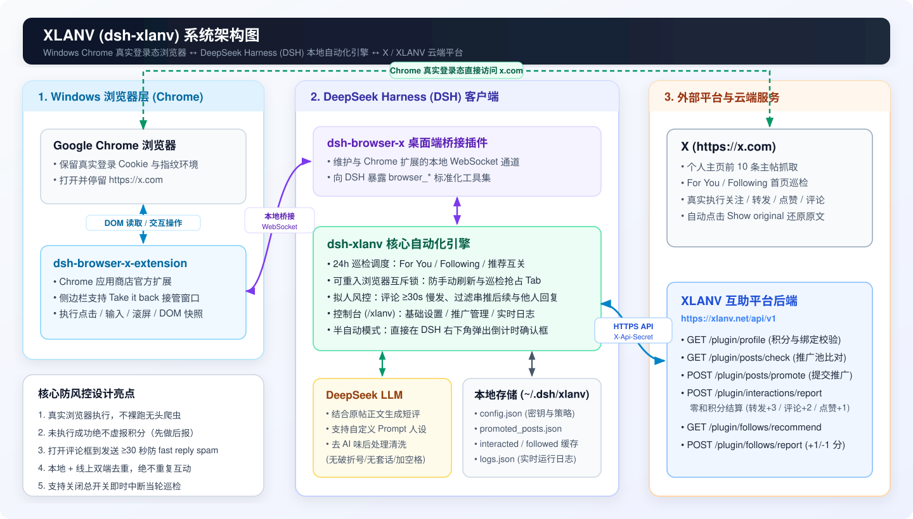

---

<details>
<summary><strong>点击展开：安装与使用总流程图（11 步）</strong></summary>

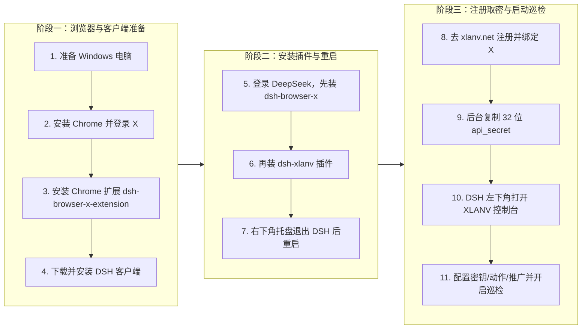

</details>

---

## Windows 端从零安装与配置图文指南

> 完整图文教程另存一份在 [docs/SETUP_GUIDE.md](./docs/SETUP_GUIDE.md)（下方与 `README` 同步展示）。

### 第 1 步：准备一台 Windows 电脑
- 建议 **Windows 10 / Windows 11**（64 位），确保可正常开启本地代理访问 `https://x.com` 与 GitHub。

### 第 2 步：安装 Chrome 浏览器并登录 X
- 下载并安装最新版 **Google Chrome**（建议版本 `>= 116`）。
- 在 Chrome 中打开 `https://x.com`，手动登录你的 X 账号（建议保持常用浏览记录与完整登录 Cookie）。

### 第 3 步：安装 Chrome 浏览器扩展（`dsh-browser-x-extension`）
- 打开 Chrome 应用商店安装扩展：
  **[https://chromewebstore.google.com/detail/dsh-browser-x-extension/mbkfinpobimaaoaihdbopehapbgfcfnj](https://chromewebstore.google.com/detail/dsh-browser-x-extension/mbkfinpobimaaoaihdbopehapbgfcfnj)**
- 点击 **「添加至 Chrome」** 完成安装。
- 若浏览器有多个窗口，可在 Chrome 侧边栏打开 **「dsh 浏览器X扩展」**；如提示连接被其他窗口占用，点击 **`Take it back`** 即可把控制权切回当前窗口：

  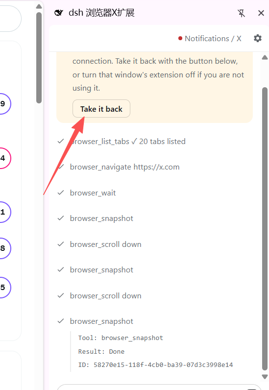

### 第 4 步：下载 DeepSeek Harness (DSH) 客户端
- 下载并安装 Windows 版 **DeepSeek Harness (DSH)** 桌面客户端。

### 第 5 步：登录 DeepSeek，先安装 `dsh-browser-x` 插件
1. 打开 DSH 客户端并登录你的 DeepSeek 账号。
2. 点击左侧 **「插件」** → 点击右上角 **「+ 添加插件」**：

   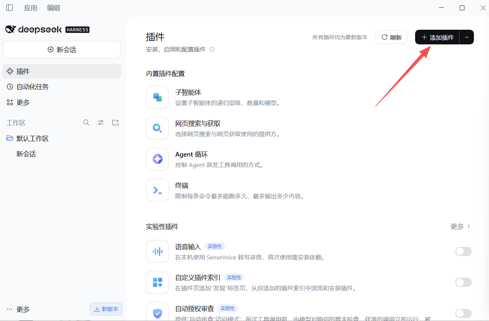

3. 在弹窗中输入 **`dsh-browser-x`**，点击 **「安装」**：

   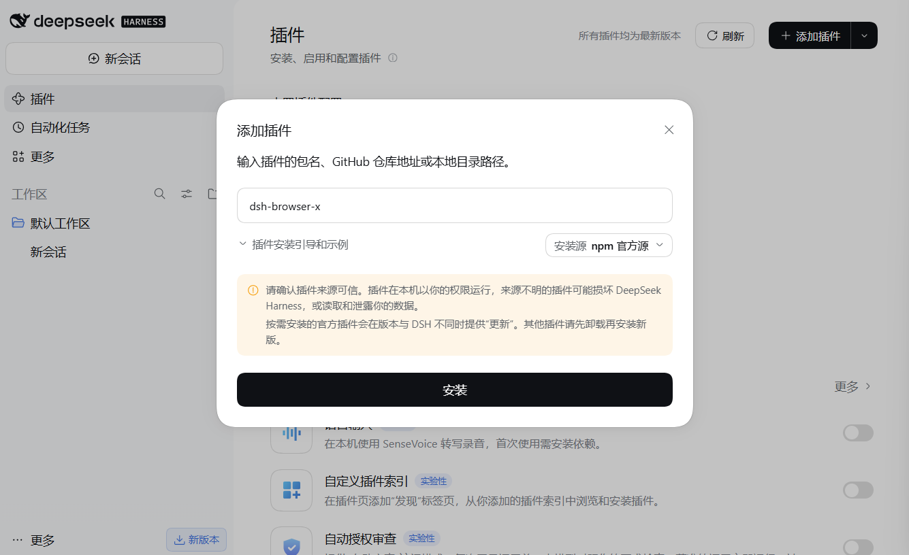

### 第 6 步：再安装 `https://github.com/wilming/dsh-xlanv` 插件
1. 再次点击右上角 **「+ 添加插件」**，输入 GitHub 仓库地址：
   ```text
   https://github.com/wilming/dsh-xlanv
   ```
   然后点击 **「安装」**：

   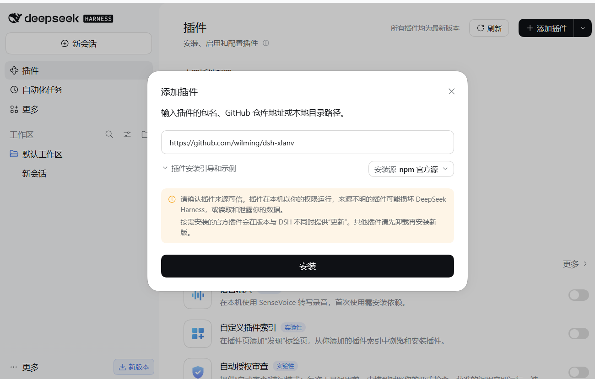

2. 等待 Git 仓库拉取与依赖安装完成：

   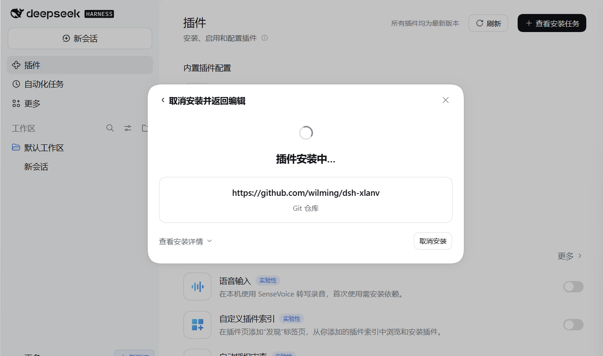

3. 安装完成后点击 **「立即启用」**：

   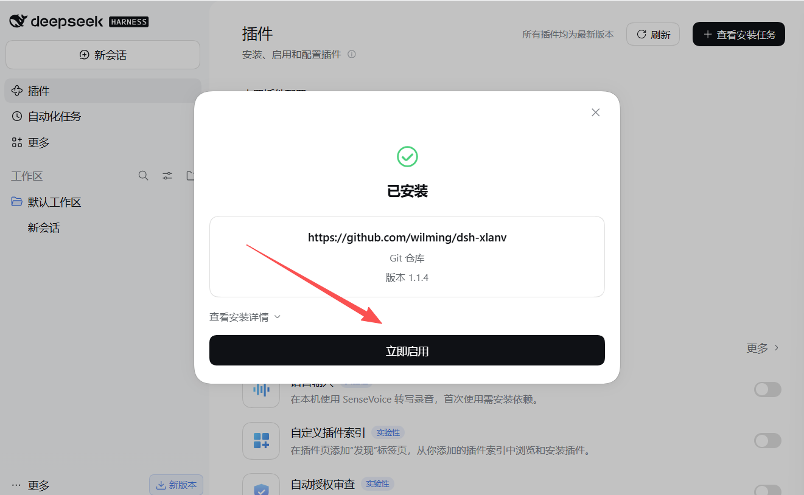

4. 在 **「已安装插件」** 列表中确认 `dsh-browser-x` 与 `dsh-xlanv` 两个插件的开关均处于开启状态：

   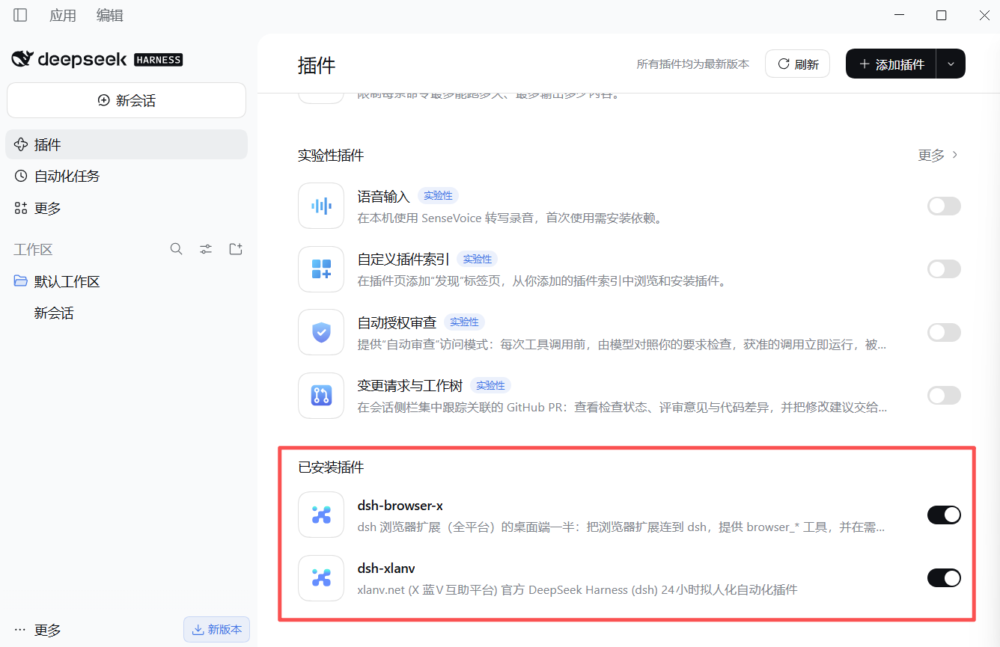

### 第 7 步：电脑右下角托盘退出 DSH 客户端然后重启
- 右键点击 Windows 桌面**右下角系统托盘**中的 DSH 图标 → 选择 **「退出」**（彻底关闭后台进程）。
- 重新打开 DSH 客户端，使浏览器桥接与注入脚本完整生效。

### 第 8 步：去 `https://xlanv.net` 注册账号
- 浏览器访问 **[https://xlanv.net](https://xlanv.net)**，使用邮箱验证码注册并登录账号（新用户默认赠送初始积分）。
- 在个人中心绑定你的 X 用户名（无需带 `@`）。

### 第 9 步：在 `https://xlanv.net` 后台复制密钥（`api_secret`）
- 在 xlanv.net 后台的 **「X 账号绑定与插件密钥」** 处，复制生成的 32 位 **`api_secret`** 密钥备用。

### 第 10 步：重启后的 DSH 左下角打开 XLANV 控制台
1. 重启 DSH 后，在主界面**左下角**会出现深蓝色的 **「XLANV 控制台」** 悬浮按钮：

   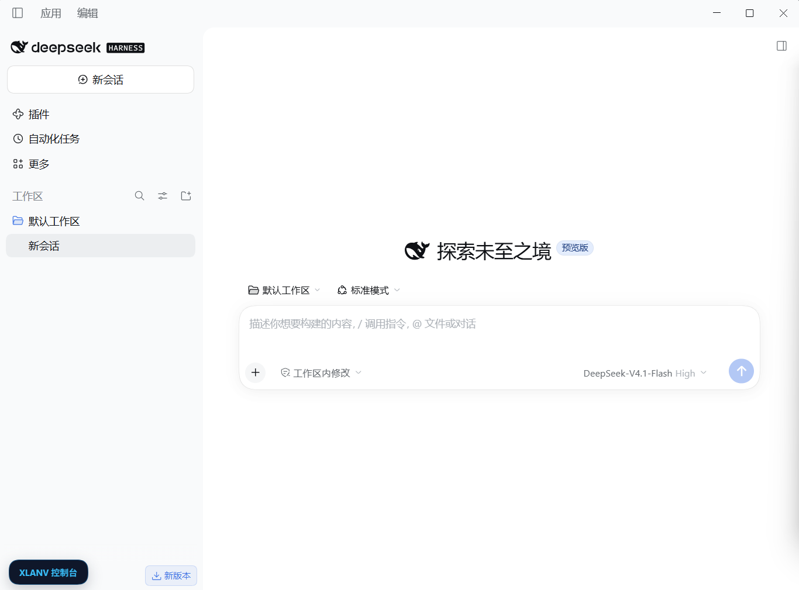

2. 点击 **「XLANV 控制台」**，右侧弹出控制抽屉，顶部包含 3 个核心标签页：**「基础设置 & Prompt」**、**「帖子推广管理」**、**「实时运行日志」**：

   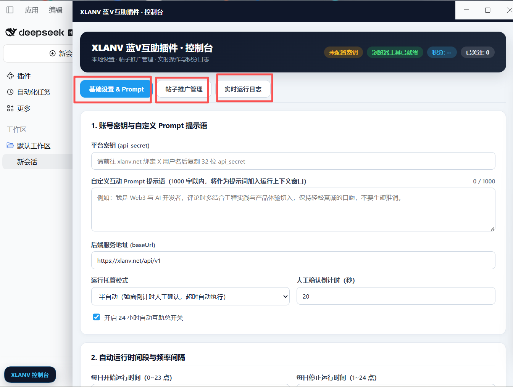

### 第 11 步：根据图示进行配置、上传推广帖子并开启定时巡检
1. **填入 `api_secret` 密钥**：
   在「基础设置 & Prompt」→「平台密钥 (api_secret)」中粘贴第 9 步复制的 32 位密钥，可按需填写自定义互动 Prompt 与选择运行托管模式（支持全自动或 DSH 右下角弹窗倒计时半自动确认）：

   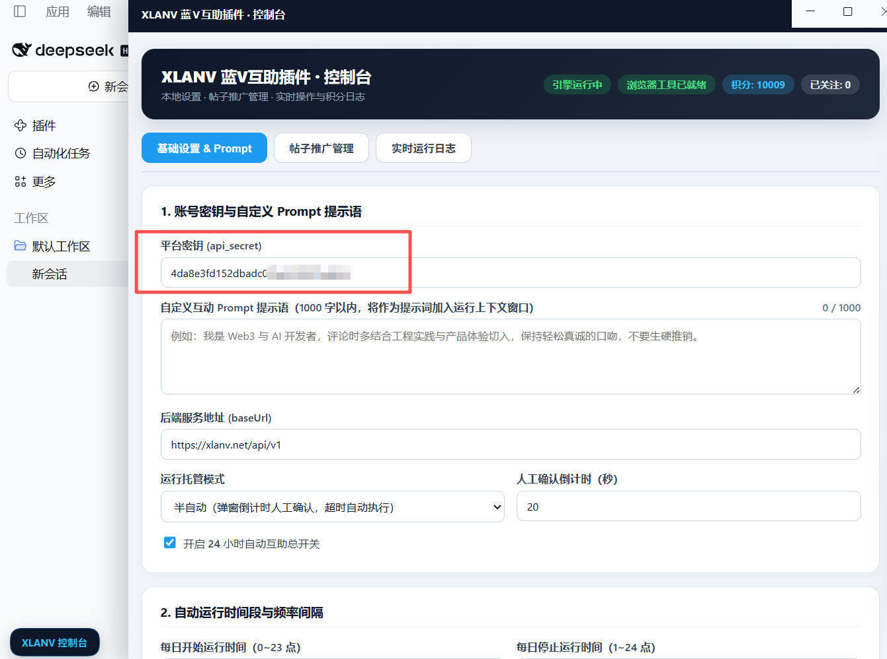

2. **配置时段、频率与互助动作并保存**：
   设置每日运行时段（如 `0~24` 点）、互动休息间隔、视口停留时长、轮询间隔，并勾选你要参与的互助动作（转发 `+3 分` / 去 AI 味拟人评论 `+2 分` / 点赞 `+1 分`），最后点击左下角 **「保存并立即生效」**（顶部徽标变为「引擎运行中」「浏览器工具已就绪」并显示当前积分）：

   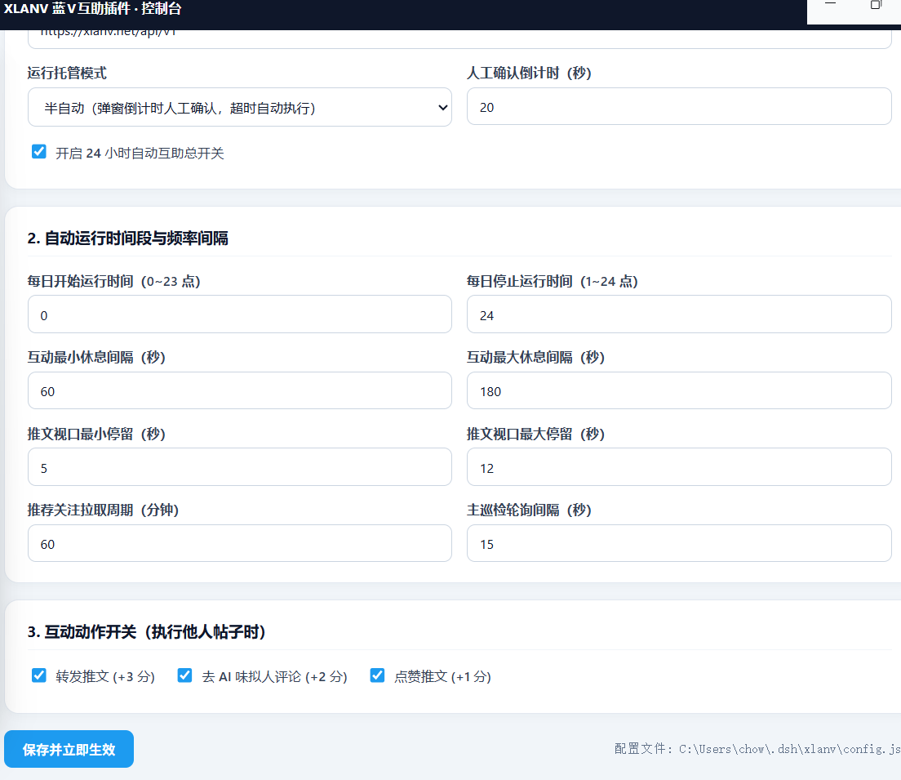

   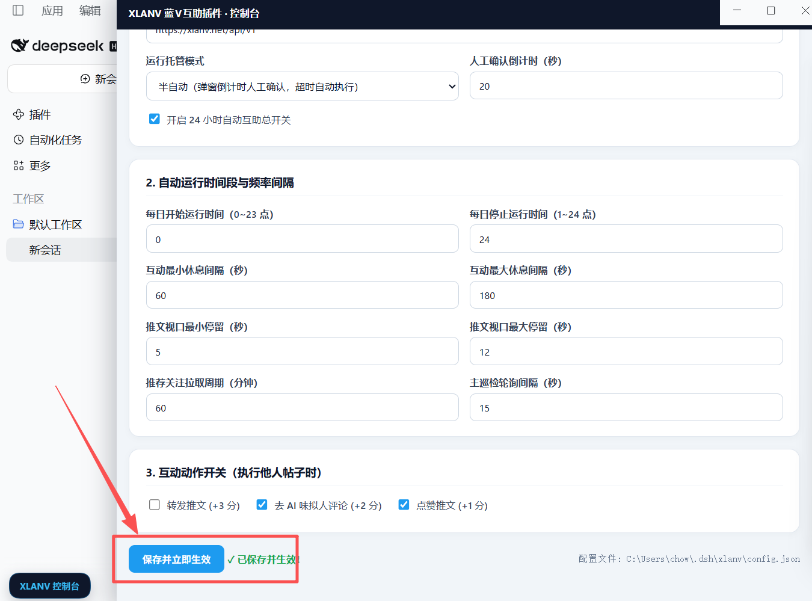

3. **抓取个人主页帖子并配置推广策略**：
   切换到 **「帖子推广管理」** 标签页，先点击右上角 **「刷新并抓取主页前 10 条帖子」**（确保 Chrome 已登录你的 X 账号）：

   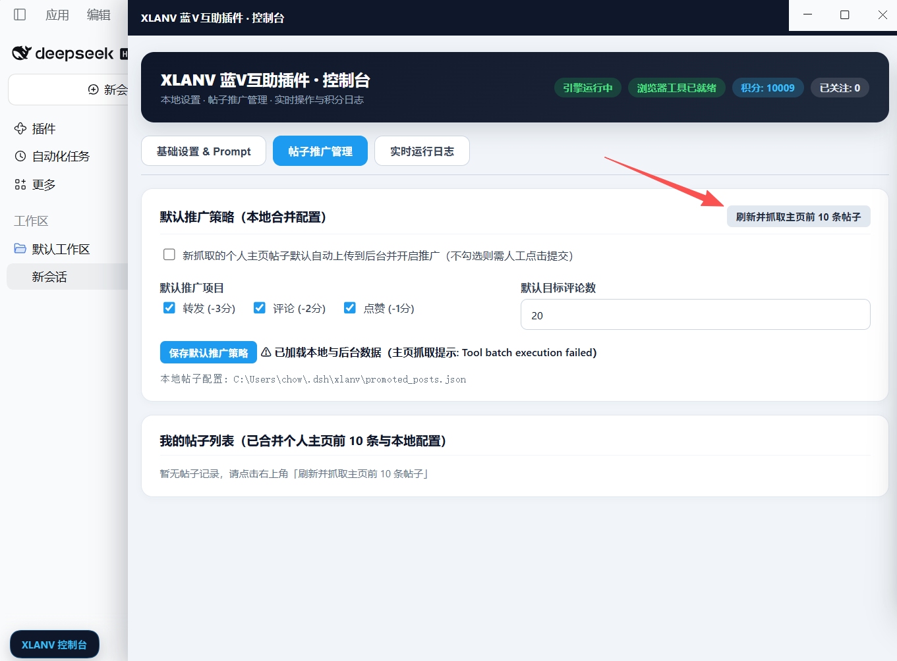

   可根据需要配置「默认推广策略」（是否新帖自动上传推广、默认推广项目及默认目标评论数）：

   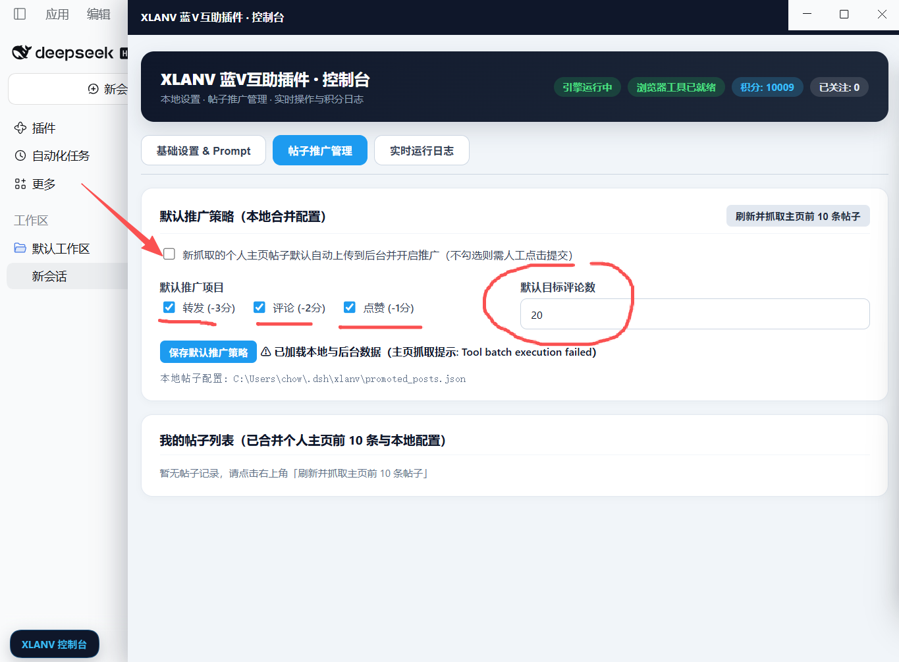

   在下方「我的帖子列表」中，针对需要推广的主帖勾选转发 / 评论 / 点赞并点击 **「提交上传推广」**，状态变为绿色 **「推广中」** 即可（也可随时更新或暂停）：

   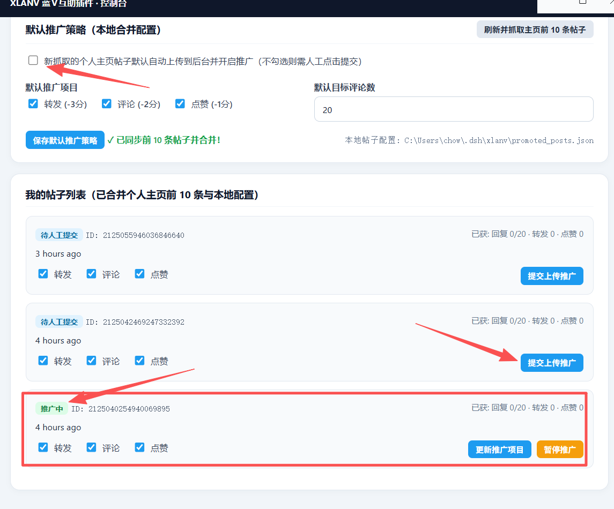

4. **在「实时运行日志」观察定时巡检与积分结算**：
   切换到 **「实时运行日志」**，可实时看到每轮首页巡检的扫描推文、线上推广池比对、`抓取原文`、`拟定评论`、`执行转发/点赞/评论（>=30 秒防风控）` 以及积分入账明细：

   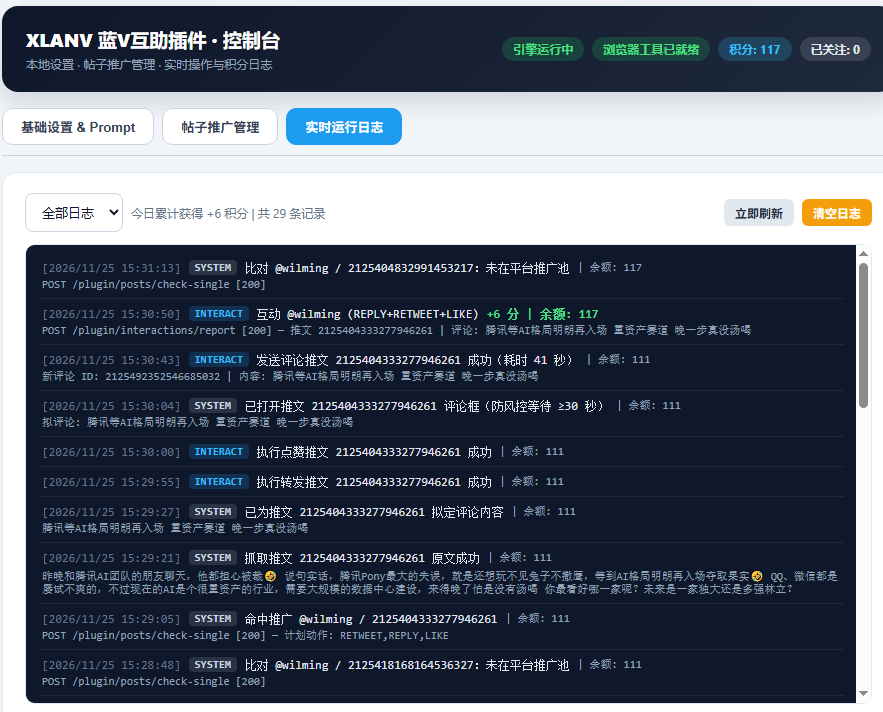

---

## 一、 核心特性

1. **24 小时自动化运行**
   - 每 60 分钟自动获取 10 名推荐会员执行关注并回传积分（`+1 / -1`）。
   - 本地缓存已关注列表，支持从服务端全量恢复。
   - 巡检 `For You` / `Following` 信息流，调用批量轻量校验接口，**严格遵守“未上传推广或积分不足绝不互动”铁律**。
   - 10% 概率触发高积分未达标强推，从关注列表头像进入主页互动，杜绝生硬 URL 直跳。
2. **半自动 20 秒确认弹窗（默认开启）**
   - 在执行评论、转发、点赞前，会在浏览器右下角弹出确认框，展示目标推文摘要、计划动作与拟发送的评论内容。
   - 你可以随时修改评论内容、点击 **立即执行** 或 **跳过本条**。
   - **若人工不干预，20 秒倒计时结束后自动执行**，兼顾安全可控与 24 小时无人值守。
3. **去 AI 味拟人评论引擎（借鉴 `lieflat-less-ai-tone`）**
   - 内置 [SKILL.md](./skills/xlanv-human-reply/SKILL.md) 与 [replyGenerator.js](./src/humanizer/replyGenerator.js) 双重清洗机制。
   - **结合原帖内容**：读取当前推文主题与关键词，拒绝万能模板套话。
   - **加入主观感受与判断**：使用第一人称口语表达真实态度（如“讲真”、“我感觉”、“之前也踩过类似的坑”）。
   - **保留真人打字特征**：
     - 严禁使用破折号（`——`、`—`、`--`）及“首先/其次/总而言之/值得注意的是”等 AI 味词汇；
     - 自动去掉末尾标点符号（`。`、`！`、`.`、`!`）；
     - 在句中随机插入 `1~3` 个自然空格，还原真人随手打字的不完美感。

---

## 二、 目录结构

```text
dsh-xlanv/
├── package.json                        # DSH 插件清单 (dsh.bundle)
├── index.js                            # DSH (Cordis) 插件入口 & 独立运行入口
├── config.example.json                 # 配置文件模板
├── skills/
│   └── xlanv-human-reply/
│       └── SKILL.md                    # 去 AI 味拟人回复 Skill 规范
├── src/
│   ├── config.js                       # 配置加载器
│   ├── api/
│   │   └── xlanvClient.js              # xlanv.net 后端全套插件 API 客户端
│   ├── browser/
│   │   └── xAutomation.js              # 24 小时巡检与拟人化时序控制引擎
│   ├── humanizer/
│   │   └── replyGenerator.js           # 去 AI 味评论生成与后处理器
│   └── ui/
│       └── confirmModal.js             # 20 秒倒计时确认弹窗
├── .gitignore
└── README.md
```

---

## 三、 安装与使用步骤

## 三、 安装与使用步骤（详细新手指南）

### 第 1 步：安装并配置 `dsh-browser-x` 浏览器服务（详细指南）

> **💡 为什么要单独安装 `dsh-browser-x`？**  
> `dsh-browser-x` 是专用的 DeepSeek Harness 浏览器基础设施插件（仓库地址：https://github.com/wilming/dsh-browser-x ）。它负责提供**防风控指纹伪装（Canvas/UserAgent/WebGL）、网络代理分流、以及推特 X 账号的持久化 Cookie 存储**。所有对推特的操作都在用户原生的指纹浏览器中运行，杜绝新起裸奔浏览器导致的异地封号风险。

#### 1. 前置环境要求
- **Node.js**：版本 `>= 18.0.0`（推荐 LTS 20.x），终端输入 `node -v` 验证；
- **本地科学上网代理**：推特在国内无法直连，需确保 Clash / Clash Verge / v2ray 等客户端已开启本地代理端口（如 `http://127.0.0.1:7890` 或 `http://127.0.0.1:10809`）；
- **已安装 DeepSeek Harness (DSH)**：终端输入 `dsh --version` 验证。

#### 2. 安装 `dsh-browser-x` 插件
请在终端中根据你的场景任选一种方式安装：

##### 方式 A：通过 GitHub 仓库直接安装（推荐）
在终端中执行以下命令，将 `dsh-browser-x` 安装到你的 `web` Profile 运行环境中：
```bash
dsh plugin --profile web add https://github.com/wilming/dsh-browser-x
```

##### 方式 B：本地源码编译安装（开发者常用）
```bash
# 1. 克隆代码仓库
git clone https://github.com/wilming/dsh-browser-x.git
cd dsh-browser-x

# 2. 安装依赖
npm install

# 3. 将本地目录挂载为 DSH 插件
dsh plugin --profile web add .
```

#### 3. 核心配置说明（重点：代理与有头模式）
在你的 DSH 配置文件（通常位于 `~/.dsh/profiles/web/config.json` 或 DSH 图形化配置面板）中，确认 `browser` 节点的关键参数：

```json
{
  "plugins": {
    "dsh-browser": {
      "headless": false,
      "proxy": "http://127.0.0.1:7890",
      "userDataDir": "./dsh_browser_data",
      "args": [
        "--disable-blink-features=AutomationControlled",
        "--no-sandbox"
      ]
    }
  }
}
```

* **`headless: false`（非常重要！）**：首次运行**务必设置为 `false`（有头可视化模式）**。这样你可以亲眼看到弹出的浏览器，并在里面安全地扫码或登录推特账号。
* **`proxy`**：必须填写你本地能正常翻墙访问 X 的 HTTP/SOCKS5 代理地址（例如 `http://127.0.0.1:7890`）。
* **`userDataDir`**：浏览器缓存持久化目录，推特登录后的 Cookie、Session 都保存在此目录下，**后续重启不用重新登录**。

#### 4. 首次启动与登录 X (Twitter) 账号
1. 启动 DSH Web 环境：
   ```bash
   dsh profile web start
   ```
2. 此时屏幕上会弹出一个由 `dsh-browser` 管理的独立 Chromium 浏览器窗口。
3. 在该浏览器地址栏中访问 `https://x.com`。
4. **手动输入你的 X（蓝V）账号与密码完成登录**：
   - 登录成功后，在信息流里随便浏览 1~2 分钟，让浏览器沉淀完整的登录态 Cookie。
   - 如果遇到推特要求验证绑定的邮箱或手机号，**直接在弹出的窗口上手工完成验证**。
5. **验证持久化**：关闭该浏览器窗口，再次运行 `dsh profile web start` 重新打开 `https://x.com`，确认已经是登录状态（无需重复登录）。

---

### 第 2 步：安装本插件 (`dsh-xlanv`)

在终端中执行以下命令，将 `dsh-xlanv` 添加到同一个 `web` Profile 中：

#### 方式 A：通过 GitHub 仓库安装
```bash
dsh plugin --profile web add https://github.com/wilming/dsh-xlanv
```

#### 方式 B：本地目录安装
如果你已经下载了本项目代码，直接在项目上级目录执行：
```bash
dsh plugin --profile web add ./plugin/dsh-xlanv
```

---

### 第 3 步：获取 `xlanv.net` 平台密钥 (`api_secret`)
1. 访问你的平台网站（如 `https://xlanv.net`），使用邮箱验证码注册（**新用户赠送 100 积分**）并登录。
2. 进入用户仪表盘，在 **“X 账号绑定与 DSH 插件密钥”** 区域填写并绑定你的 X 用户名（如 `elonmusk`，无需带 `@`）。
3. 绑定后系统会自动生成该账号专属的 32 位 `api_secret`，点击 **“复制密钥”** 按钮备用。

---

### 第 4 步：配置与启动运行

#### 1. 配置文件（可选）
在 `plugin/dsh-xlanv` 目录下，复制 `config.example.json` 为 `config.json`：
```json
{
  "baseUrl": "https://xlanv.net/api/v1",
  "apiSecret": "填入你的32位api_secret",
  "mode": "semi-auto",
  "confirmTimeoutSeconds": 20,
  "actions": {
    "retweet": true,
    "reply": true,
    "like": true
  }
}
```
> **提示**：如果未在 `config.json` 预先填入 `apiSecret`，**插件首次启动时会自动在浏览器右下角弹出精美悬浮输入框**，引导你粘贴密钥，保存后自动存入文件，后续无需手动修改。

#### 2. 正式启动运行
在 DSH 控制台中启动服务即可开始 24 小时拟人化自动互助：
```bash
dsh profile web start
```

---

### 第 5 步：常见问题与排错指南 (Troubleshooting)

#### Q1: 启动后报错 `Cannot find module 'playwright'` 或 `Executable doesn't exist`？
* **原因**：初次安装缺少 Chromium 内核二进制文件。
* **解决办法**：在终端执行以下命令手动补全安装内核：
  ```bash
  npx playwright install chromium
  ```

#### Q2: 浏览器打开后一片空白，或者打不开 `x.com`（提示无法连接）？
* **原因**：没有正确配置本地翻墙代理。
* **解决办法**：
  1. 确认你的 VPN/Clash 客户端处于开启状态，并且允许了本地局域网连接；
  2. 检查 `proxy` 配置是否匹配你的客户端端口（Clash 常见为 `7890`，v2ray 常见为 `10809`）；
  3. 可以在配置里尝试填 `http://127.0.0.1:7890`。

#### Q3: 运行过程中推特跳出机器人验证码 / Cloudflare 拦截怎么办？
* **解决办法**：
  由于 `dsh-browser` 是在桌面弹出的可视化窗口中运行，遇到验证码时插件会自动暂停，**你只需直接用鼠标在浏览器上手工点击滑块或点选图片完成验证**，验证通过后插件会恢复自动巡检。

#### Q4: 提示端口冲突（`Port 9222 already in use`）？
* **原因**：上次关闭时残留了 Chromium 僵尸后台进程。
* **解决办法**：
  - Windows: 打开任务管理器，结束名为 `Chrome.exe` 或 `Chromium.exe` 的残留进程；
  - macOS/Linux: 终端执行 `killall Chromium` 或 `pkill -f chromium`。

---

## 四、 开源协议
MIT License
